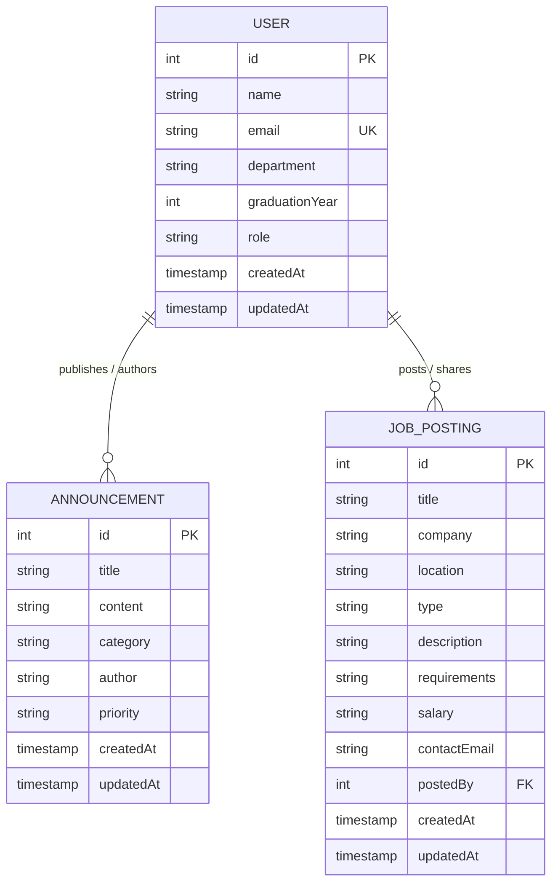
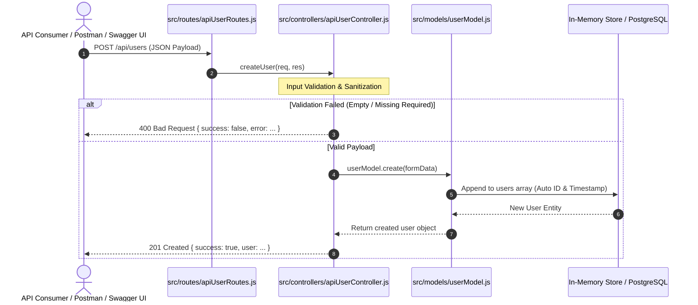
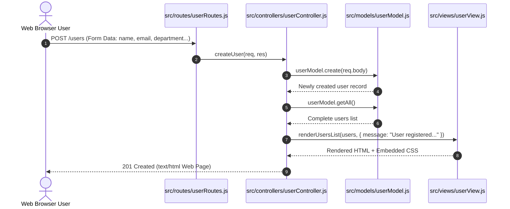

# 📊 Data Design Documentation (DDD)

> **Alumni Tracking System**  
> *Version:* 1.0.0  
> *Architecture:* Model-View-Controller (MVC)  
> *Scope:* Data Architecture, Domain Entities, In-Memory Storage, ER Diagrams, Data Flow Lifecycles, and Relational Database (PostgreSQL) Blueprint  
> 🔗 **Application Overview & Operations Guide:** [README.md](./README.md)

---

## 📑 Table of Contents

1. [Overview & Architectural Context](#1-overview--architectural-context)
2. [Domain Entities & Information Schema](#2-domain-entities--information-schema)
   - [2.1 User (Alumni) Entity](#21-user-alumni-entity)
   - [2.2 Announcement Entity](#22-announcement-entity)
   - [2.3 JobPosting Entity](#23-jobposting-entity)
   - [2.4 Entity-Relationship Diagram (ERD)](#24-entity-relationship-diagram-erd)
3. [Storage Implementation & Data Volatility Analysis](#3-storage-implementation--data-volatility-analysis)
   - [3.1 In-Memory Storage Architecture](#31-in-memory-storage-architecture)
   - [3.2 The Forgetting Test (Data Volatility Demonstration)](#32-the-forgetting-test-data-volatility-demonstration)
4. [Model Interface & CRUD Operations Contract](#4-model-interface--crud-operations-contract)
   - [4.1 UserModel CRUD Interface](#41-usermodel-crud-interface)
   - [4.2 AnnouncementModel CRUD Interface](#42-announcementmodel-crud-interface)
   - [4.3 JobPostingModel CRUD Interface](#43-jobpostingmodel-crud-interface)
5. [Data Flow & Lifecycle across the MVC Architecture](#5-data-flow--lifecycle-across-the-mvc-architecture)
   - [5.1 RESTful JSON API Data Flow](#51-restful-json-api-data-flow)
   - [5.2 Web Interface Form Submission Data Flow](#52-web-interface-form-submission-data-flow)
6. [Relational Database (PostgreSQL) Transition Blueprint](#6-relational-database-postgresql-transition-blueprint)
   - [6.1 Production DDL Schemas](#61-production-ddl-schemas)
   - [6.2 Constraints, Indexing Strategy & Triggers](#62-constraints-indexing-strategy--triggers)
   - [6.3 Persistent Volume Architecture (`postgres_data`)](#63-persistent-volume-architecture-postgres_data)
7. [Validation, Sanitization & Data Integrity Rules](#7-validation-sanitization--data-integrity-rules)
8. [Data Query & Controller Action Matrix](#8-data-query--controller-action-matrix)
9. [Factory & Seeder Pattern Architecture](#9-factory--seeder-pattern-architecture)
   - [9.1 Entity Factories (`factories/`)](#91-entity-factories-factories)
   - [9.2 Automated Seeder Runner (`scripts/seed.js`)](#92-automated-seeder-runner-scriptsseedjs)

---

## 1. Overview & Architectural Context

The **Alumni Tracking System** is architected using the **Model-View-Controller (MVC)** design pattern. In this architecture, the **Model Layer** (`src/models/userModel.js`, `src/models/announcementModel.js`, and `src/models/jobPostingModel.js`) encapsulates all domain state, entity definitions, validation rules, and data mutation primitives.

### Core Architectural Principles:
* **Decoupled Persistence (Separation of Concerns):** Business controllers (`userController`, `apiUserController`, `announcementController`, `apiAnnouncementController`, `jobPostingController`, `apiJobPostingController`) interact strictly with model abstractions. Controllers remain agnostic to underlying storage mechanics (whether in-memory heap, JSON files, or PostgreSQL).
* **Single Source of Truth:** Models operate as singleton instances exported across the application, guaranteeing consistent entity state across both Server-Side Rendered (SSR) HTML views and RESTful JSON APIs.
* **Deterministic Contract:** Every mutation and query method enforces consistent return types, standardized timestamp formatting (ISO 8601 UTC), and deterministic primary key increments.

---

## 2. Domain Entities & Information Schema

The application models three primary business domains: **User (Alumni Profile)**, **Announcement (Campus & Alumni Broadcasts)**, and **JobPosting (Career Opportunities)**.

### 2.1 User (Alumni) Entity

Represents an alumnus, student, faculty member, or system administrator registered in the network.

| Attribute | Data Type | Nullable | Default | Description |
| :--- | :--- | :---: | :--- | :--- |
| **`id`** | `INTEGER` | ❌ No | Auto-increment (`1, 2, ...`) | Unique primary identifier. |
| **`name`** | `VARCHAR(255)` | ❌ No | - | Full name of the graduate. |
| **`email`** | `VARCHAR(255)` | ❌ No | - | Unique electronic mail address. |
| **`department`** | `VARCHAR(255)` | ❌ No | - | Academic department / graduation program. |
| **`graduationYear`** | `INTEGER` | ❌ No | - | Four-digit calendar year of graduation. |
| **`role`** | `VARCHAR(50)` | ❌ No | `'alumni'` | Authorization role (`'alumni'`, `'admin'`). |
| **`createdAt`** | `TIMESTAMP (ISO 8601)` | ❌ No | `CURRENT_TIMESTAMP` | System record creation timestamp. |
| **`updatedAt`** | `TIMESTAMP (ISO 8601)` | ✅ Yes | `null` | Timestamp of last modification. |

#### User JSON Representation:
```json
{
  "id": 1,
  "name": "Ece Yakali",
  "email": "ece@example.com",
  "department": "Computer Engineering",
  "graduationYear": 2024,
  "role": "alumni",
  "createdAt": "2026-10-14T20:00:00.000Z",
  "updatedAt": null
}
```

---

### 2.2 Announcement Entity

Represents broadcast communications, job opportunities, reunion invitations, and institutional updates.

| Attribute | Data Type | Nullable | Default | Description |
| :--- | :--- | :---: | :--- | :--- |
| **`id`** | `INTEGER` | ❌ No | Auto-increment (`1, 2, ...`) | Unique announcement identifier. |
| **`title`** | `VARCHAR(255)` | ❌ No | - | Headline of the broadcast. |
| **`content`** | `TEXT` | ❌ No | - | Detailed body text of the announcement. |
| **`category`** | `VARCHAR(100)` | ❌ No | `'General'` | Category tag (`Career`, `Event`, `Academic`, `General`). |
| **`author`** | `VARCHAR(255)` | ❌ No | `'Alumni Association'` | Publishing author or committee name. |
| **`priority`** | `VARCHAR(20)` | ❌ No | `'normal'` | Urgency level (`low`, `normal`, `high`, `urgent`). |
| **`createdAt`** | `TIMESTAMP (ISO 8601)` | ❌ No | `CURRENT_TIMESTAMP` | Publication timestamp. |
| **`updatedAt`** | `TIMESTAMP (ISO 8601)` | ✅ Yes | `null` | Timestamp of last content revision. |

#### Announcement JSON Representation:
```json
{
  "id": 1,
  "title": "Annual Alumni Reunion 2026",
  "content": "Join us on campus for our annual networking gala and alumni dinner.",
  "category": "Event",
  "author": "Alumni Office",
  "priority": "high",
  "createdAt": "2026-10-14T20:00:00.000Z",
  "updatedAt": null
}
```

---

### 2.3 JobPosting Entity

Represents employment vacancies, internship opportunities, and career announcements shared across the alumni network.

| Attribute | Data Type | Nullable | Default | Description |
| :--- | :--- | :---: | :--- | :--- |
| **`id`** | `INTEGER` | ❌ No | Auto-increment (`1, 2, ...`) | Unique job posting primary identifier. |
| **`title`** | `VARCHAR(255)` | ❌ No | - | Role / position headline (e.g. 'Software Engineer'). |
| **`company`** | `VARCHAR(255)` | ❌ No | - | Hiring organization or employer name. |
| **`location`** | `VARCHAR(255)` | ❌ No | `'Remote'` | Geographic work location, city, or remote policy. |
| **`type`** | `VARCHAR(50)` | ❌ No | `'full-time'` | Employment type (`'full-time'`, `'part-time'`, `'contract'`, `'internship'`, `'remote'`). |
| **`description`** | `TEXT` | ❌ No | - | In-depth role responsibilities and specifications. |
| **`requirements`** | `TEXT` | ✅ Yes | `null` | Candidate qualifications, technical skills, and experience prerequisites. |
| **`salary`** | `VARCHAR(100)` | ✅ Yes | `null` | Compensation range or terms (e.g. `'$80k - $100k'` or `'Competitive'`). |
| **`contactEmail`** | `VARCHAR(255)` | ✅ Yes | `null` | Application submission or inquiry email address. |
| **`postedBy`** | `INTEGER` | ✅ Yes | `null` | User ID of the alumnus/recruiter creating the posting (`FK -> users.id`). |
| **`createdAt`** | `TIMESTAMP (ISO 8601)` | ❌ No | `CURRENT_TIMESTAMP` | System record creation timestamp. |
| **`updatedAt`** | `TIMESTAMP (ISO 8601)` | ✅ Yes | `null` | Timestamp of last modification. |

#### JobPosting JSON Representation:
```json
{
  "id": 1,
  "title": "Software Engineer (Backend)",
  "company": "TechCorp Solutions",
  "location": "Istanbul / Remote",
  "type": "full-time",
  "description": "Designing and developing robust microservices and high-throughput REST APIs.",
  "requirements": "Proficiency in Node.js, Express, PostgreSQL, and Docker.",
  "salary": "$75,000 - $95,000",
  "contactEmail": "careers@techcorp.com",
  "postedBy": 1,
  "createdAt": "2026-10-21T20:00:00.000Z",
  "updatedAt": null
}
```

---

### 2.4 Entity-Relationship Diagram (ERD)



---

## 3. Storage Implementation & Data Volatility Analysis

### 3.1 In-Memory Storage Architecture

In the initial development phase, entities reside within Node.js process heap memory:
```javascript
// Internal memory storage (src/models/userModel.js)
let users = [];

// Internal memory storage (src/models/announcementModel.js)
let announcements = [];

// Internal memory storage (src/models/jobPostingModel.js)
let jobPostings = [];
```

#### Lifecycle & Concurrency Characteristics:
* **Storage Location:** Allocations reside strictly inside V8 engine memory heap (`RAM`).
* **Performance:** Sub-millisecond retrieval and insertion with $O(1)$ lookup via array index or $O(N)$ filter by ID.
* **Concurrency:** Single-threaded event loop processes mutations sequentially, preventing standard multi-thread race conditions.
* **Scope:** Singleton reference shared across all incoming HTTP requests during process lifetime.

---

### 3.2 The Forgetting Test (Data Volatility Demonstration)

While in-memory storage offers zero-dependency rapid prototyping, it suffers from **memory volatility (process amnesia)**:

```
[In-Memory Volatility Demonstration]
┌────────────────────────────────────────────────────────┐
│  1. Node.js Express Server / Container Running         │
│     Heap RAM: User ID 1 ("Forgetting Test User")        │
└────────────────────────────────────────────────────────┘
                            │
               docker compose down / kill
                            ▼
┌────────────────────────────────────────────────────────┐
│  2. Container Destroyed / Process Exits                │
│     Heap RAM completely deallocated! All data lost!   │
└────────────────────────────────────────────────────────┘
                            │
               docker compose up -d / restart
                            ▼
┌────────────────────────────────────────────────────────┐
│  3. Fresh Server Process Started                       │
│     Heap RAM reinitialized: users = []                 │
│     💥 "Forgetting Test User" WAS FORGOTTEN!           │
└────────────────────────────────────────────────────────┘
```

#### Empirical Demonstration Commands:
```bash
# 1. Create a record in memory:
curl -X POST http://localhost:5000/api/users \
  -H "Content-Type: application/json" \
  -d '{"name":"Forgetting Test User","email":"forgetting.test@alumni.edu","department":"Computer Engineering"}'
# Status: 201 Created -> {"id":1,"name":"Forgetting Test User",...}

# 2. Verify existence in RAM:
curl http://localhost:5000/api/users
# Status: 200 OK -> [{"id":1,"name":"Forgetting Test User",...}]

# 3. Teardown container / stop process:
docker compose down

# 4. Rebuild / restart container:
docker compose up -d

# 5. Query records:
curl http://localhost:5000/api/users
# Status: 200 OK -> {"success":true,"count":0,"data":[]}
# Result: The record was lost!
```

> **Pedagogical Conclusion:**  
> In-memory databases cannot provide durability (the **D** in **ACID**). To guarantee persistence beyond container lifecycles, data must be stored on persistent disk volumes backed by a relational database management system (PostgreSQL).

---

## 4. Model Interface & CRUD Operations Contract

All models implement a uniform, clean CRUD contract providing deterministic inputs and outputs.

### 4.1 UserModel CRUD Interface

```typescript
interface UserModelContract {
  // CREATE (PostgreSQL INSERT ... ON CONFLICT / Memory Fallback)
  create(userData: {
    name: string;
    email: string;
    department?: string;
    graduationYear?: number | string;
    role?: string;
  }): Promise<User> & User;

  // READ ALL (PostgreSQL SELECT ... ORDER BY id ASC / Memory)
  findAll(): Promise<User[]> & User[];
  getAll(): Promise<User[]> & User[];

  // READ BY ID (PostgreSQL SELECT ... WHERE id = $1)
  findById(id: number | string): Promise<User | null> & (User | null);
  getById(id: number | string): Promise<User | null> & (User | null);

  // READ BY EMAIL (PostgreSQL SELECT ... WHERE LOWER(email) = LOWER($1))
  findByEmail(email: string): Promise<User | null> & (User | null);

  // UPDATE (PostgreSQL UPDATE users SET ... WHERE id = $6 RETURNING ...)
  update(id: number | string, updateData: Partial<User>): Promise<User | null> & (User | null);

  // DELETE (PostgreSQL DELETE FROM users WHERE id = $1 RETURNING ...)
  delete(id: number | string): Promise<User | null> & (User | null);
  remove(id: number | string): Promise<User | null> & (User | null);

  // UTILITIES & HEALTH
  count(): number;
  clear(): void;
  isDbConnected(): Promise<boolean>;
}
```

---

### 4.2 AnnouncementModel CRUD Interface

```typescript
interface AnnouncementModelContract {
  // CREATE (PostgreSQL INSERT INTO announcements ... RETURNING ...)
  create(data: {
    title: string;
    content: string;
    category?: string;
    author?: string;
    priority?: 'low' | 'normal' | 'high' | 'urgent';
  }): Promise<Announcement> & Announcement;

  // READ ALL (PostgreSQL SELECT ... ORDER BY id ASC)
  findAll(): Promise<Announcement[]> & Announcement[];
  getAll(): Promise<Announcement[]> & Announcement[];

  // READ BY ID (PostgreSQL SELECT ... WHERE id = $1)
  findById(id: number | string): Promise<Announcement | null> & (Announcement | null);
  getById(id: number | string): Promise<Announcement | null> & (Announcement | null);

  // READ BY CATEGORY (PostgreSQL SELECT ... WHERE LOWER(category) = LOWER($1))
  findByCategory(category: string): Promise<Announcement[]> & Announcement[];

  // UPDATE (PostgreSQL UPDATE announcements SET ... WHERE id = $6 RETURNING ...)
  update(id: number | string, updateData: Partial<Announcement>): Promise<Announcement | null> & (Announcement | null);

  // DELETE (PostgreSQL DELETE FROM announcements WHERE id = $1 RETURNING ...)
  delete(id: number | string): Promise<Announcement | null> & (Announcement | null);
  remove(id: number | string): Promise<Announcement | null> & (Announcement | null);

  // UTILITIES & HEALTH
  count(): number;
  clear(): void;
  isDbConnected(): Promise<boolean>;
}
```

---

### 4.3 JobPostingModel CRUD Interface

```typescript
interface JobPostingModelContract {
  // CREATE (PostgreSQL INSERT INTO job_postings ... RETURNING ...)
  create(data: {
    title: string;
    company: string;
    location?: string;
    type?: 'full-time' | 'part-time' | 'contract' | 'internship' | 'remote';
    description: string;
    requirements?: string;
    salary?: string;
    contactEmail?: string;
    postedBy?: number | string;
  }): Promise<JobPosting> & JobPosting;

  // READ ALL (PostgreSQL SELECT ... ORDER BY id ASC)
  findAll(): Promise<JobPosting[]> & JobPosting[];
  getAll(): Promise<JobPosting[]> & JobPosting[];

  // READ BY ID (PostgreSQL SELECT ... WHERE id = $1)
  findById(id: number | string): Promise<JobPosting | null> & (JobPosting | null);
  getById(id: number | string): Promise<JobPosting | null> & (JobPosting | null);

  // READ BY COMPANY (PostgreSQL SELECT ... WHERE LOWER(company) = LOWER($1))
  findByCompany(company: string): Promise<JobPosting[]> & JobPosting[];

  // READ BY EMPLOYMENT TYPE (PostgreSQL SELECT ... WHERE type = $1)
  findByType(type: string): Promise<JobPosting[]> & JobPosting[];

  // UPDATE (PostgreSQL UPDATE job_postings SET ... WHERE id = $X RETURNING ...)
  update(id: number | string, updateData: Partial<JobPosting>): Promise<JobPosting | null> & (JobPosting | null);

  // DELETE (PostgreSQL DELETE FROM job_postings WHERE id = $1 RETURNING ...)
  delete(id: number | string): Promise<JobPosting | null> & (JobPosting | null);
  remove(id: number | string): Promise<JobPosting | null> & (JobPosting | null);

  // UTILITIES & HEALTH
  count(): number;
  clear(): void;
  isDbConnected(): Promise<boolean>;
}
```

---

## 5. Data Flow & Lifecycle across the MVC Architecture

### 5.1 RESTful JSON API Data Flow



---

### 5.2 Web Interface Form Submission Data Flow



---

## 6. Relational Database (PostgreSQL) Transition Blueprint

To transition from in-memory volatile storage to production-grade persistent storage, the following relational database architecture is defined.

### 6.1 Production DDL Schemas

```sql
-- PostgreSQL 16 Production Schema
-- Database: alumni_db

CREATE TABLE IF NOT EXISTS users (
    id SERIAL PRIMARY KEY,
    name VARCHAR(255) NOT NULL,
    email VARCHAR(255) UNIQUE NOT NULL,
    department VARCHAR(255),
    graduation_year INTEGER,
    role VARCHAR(50) DEFAULT 'alumni' CHECK (role IN ('alumni', 'admin', 'faculty', 'student')),
    created_at TIMESTAMP WITH TIME ZONE DEFAULT CURRENT_TIMESTAMP,
    updated_at TIMESTAMP WITH TIME ZONE DEFAULT CURRENT_TIMESTAMP
);

CREATE TABLE IF NOT EXISTS announcements (
    id SERIAL PRIMARY KEY,
    title VARCHAR(255) NOT NULL,
    content TEXT NOT NULL,
    category VARCHAR(100) DEFAULT 'General',
    author VARCHAR(255) DEFAULT 'Alumni Association',
    priority VARCHAR(20) DEFAULT 'normal' CHECK (priority IN ('low', 'normal', 'high', 'urgent')),
    created_at TIMESTAMP WITH TIME ZONE DEFAULT CURRENT_TIMESTAMP,
    updated_at TIMESTAMP WITH TIME ZONE DEFAULT CURRENT_TIMESTAMP
);

CREATE TABLE IF NOT EXISTS job_postings (
    id SERIAL PRIMARY KEY,
    title VARCHAR(255) NOT NULL,
    company VARCHAR(255) NOT NULL,
    location VARCHAR(255) DEFAULT 'Remote',
    type VARCHAR(50) DEFAULT 'full-time' CHECK (type IN ('full-time', 'part-time', 'contract', 'internship', 'remote')),
    description TEXT NOT NULL,
    requirements TEXT,
    salary VARCHAR(100),
    contact_email VARCHAR(255),
    posted_by INTEGER REFERENCES users(id) ON DELETE SET NULL,
    created_at TIMESTAMP WITH TIME ZONE DEFAULT CURRENT_TIMESTAMP,
    updated_at TIMESTAMP WITH TIME ZONE DEFAULT CURRENT_TIMESTAMP
);
```

---

### 6.2 Constraints, Indexing Strategy & Triggers

1. **Email Uniqueness & Lookup Index:**
   ```sql
   CREATE UNIQUE INDEX idx_users_email_lower ON users (LOWER(email));
   ```
2. **Announcement Category & Priority Query Index:**
   ```sql
   CREATE INDEX idx_announcements_category ON announcements (category);
   CREATE INDEX idx_announcements_created_at ON announcements (created_at DESC);
   ```
3. **Job Posting Search, Filter & Foreign Key Indexes:**
   ```sql
   CREATE INDEX idx_job_postings_company ON job_postings (LOWER(company));
   CREATE INDEX idx_job_postings_type ON job_postings (type);
   CREATE INDEX idx_job_postings_posted_by ON job_postings (posted_by);
   CREATE INDEX idx_job_postings_created_at ON job_postings (created_at DESC);
   ```
4. **Automated `updated_at` Timestamp Trigger:**
   ```sql
   CREATE OR REPLACE FUNCTION update_timestamp_column()
   RETURNS TRIGGER AS $$
   BEGIN
       NEW.updated_at = CURRENT_TIMESTAMP;
       RETURN NEW;
   END;
   $$ LANGUAGE plpgsql;

   CREATE TRIGGER trg_users_updated_at
       BEFORE UPDATE ON users
       FOR EACH ROW
       EXECUTE FUNCTION update_timestamp_column();

   CREATE TRIGGER trg_announcements_updated_at
       BEFORE UPDATE ON announcements
       FOR EACH ROW
       EXECUTE FUNCTION update_timestamp_column();

   CREATE TRIGGER trg_job_postings_updated_at
       BEFORE UPDATE ON job_postings
       FOR EACH ROW
       EXECUTE FUNCTION update_timestamp_column();
   ```

---

### 6.3 Persistent Volume Architecture (`postgres_data`)

In `docker-compose.yml`, persistent disk storage is managed via a Docker Named Volume:

```yaml
services:
  db:
    image: postgres:16-alpine
    container_name: alumni_db
    restart: unless-stopped
    ports:
      - "5432:5432"
    environment:
      POSTGRES_USER: postgres
      POSTGRES_PASSWORD: postgres
      POSTGRES_DB: alumni_db
    volumes:
      - postgres_data:/var/lib/postgresql/data
      - ./docker/init.sql:/docker-entrypoint-initdb.d/init.sql:ro

volumes:
  postgres_data:
    driver: local
```

* **Durable Storage:** Container restarts (`docker compose down` ➡️ `docker compose up`) mount `postgres_data` automatically, permanently resolving the **Forgetting Test** volatility problem.

---

## 7. Validation, Sanitization & Data Integrity Rules

| Field | Rule / Constraint | Action on Failure |
| :--- | :--- | :--- |
| **`User.name`** | Non-empty string, min length 2, max length 255. | HTTP `400 Bad Request` |
| **`User.email`** | Valid RFC 5322 format: `/^[^\s@]+@[^\s@]+\.[^\s@]+$/`. | HTTP `400 Bad Request` |
| **`User.graduationYear`** | Numeric integer between `1950` and `2100`. | HTTP `400 Bad Request` |
| **`Announcement.title`** | Non-empty string, min length 3, max length 255. | HTTP `400 Bad Request` |
| **`Announcement.content`** | Non-empty text, min length 5. | HTTP `400 Bad Request` |
| **`Announcement.priority`** | Must match: `'low' \| 'normal' \| 'high' \| 'urgent'`. | Defaults to `'normal'` |
| **`JobPosting.title`** | Non-empty string, min length 3, max length 255. | HTTP `400 Bad Request` |
| **`JobPosting.company`** | Non-empty string, min length 2, max length 255. | HTTP `400 Bad Request` |
| **`JobPosting.description`** | Non-empty text, min length 10. | HTTP `400 Bad Request` |
| **`JobPosting.type`** | Must match: `'full-time' \| 'part-time' \| 'contract' \| 'internship' \| 'remote'`. | Defaults to `'full-time'` |
| **`JobPosting.contactEmail`** | Valid RFC 5322 format if provided. | HTTP `400 Bad Request` |

---

## 8. Data Query & Controller Action Matrix

| HTTP Method | Route URI | Controller Method | Model Method | Success Status | Error Status |
| :---: | :--- | :--- | :--- | :---: | :---: |
| **GET** | `/api/users` | `apiUserController.getAllUsers` | `userModel.getAll()` | `200 OK` | - |
| **POST** | `/api/users` | `apiUserController.createUser` | `userModel.create(data)` | `201 Created` | `400 Bad Request` |
| **GET** | `/api/users/:id` | `apiUserController.getUserById` | `userModel.getById(id)` | `200 OK` | `404 Not Found` |
| **PUT/PATCH**| `/api/users/:id` | `apiUserController.updateUser` | `userModel.update(id, data)` | `200 OK` | `404 Not Found` |
| **DELETE** | `/api/users/:id` | `apiUserController.deleteUser` | `userModel.delete(id)` | `200 OK` | `404 Not Found` |
| **GET** | `/users` | `userController.getAllUsers` | `userModel.getAll()` | `200 OK` | - |
| **POST** | `/users` | `userController.createUser` | `userModel.create(data)` | `201 Created` | `400 Bad Request` |
| **GET** | `/users/:id` | `userController.getUserById` | `userModel.getById(id)` | `200 OK` | `404 Not Found` |
| **GET** | `/api/announcements` | `apiAnnouncementController.getAllAnnouncements` | `announcementModel.getAll()` | `200 OK` | - |
| **POST** | `/api/announcements` | `apiAnnouncementController.createAnnouncement` | `announcementModel.create(data)` | `201 Created` | `400 Bad Request` |
| **GET** | `/api/announcements/:id` | `apiAnnouncementController.getAnnouncementById` | `announcementModel.getById(id)`| `200 OK` | `404 Not Found` |
| **PUT/PATCH**| `/api/announcements/:id`| `apiAnnouncementController.updateAnnouncement` | `announcementModel.update(id, data)`| `200 OK` | `404 Not Found` |
| **DELETE** | `/api/announcements/:id`| `apiAnnouncementController.deleteAnnouncement` | `announcementModel.delete(id)` | `200 OK` | `404 Not Found` |
| **GET** | `/announcements` | `announcementController.getAllAnnouncements` | `announcementModel.getAll()` | `200 OK` | - |
| **POST** | `/announcements` | `announcementController.createAnnouncement` | `announcementModel.create(data)` | `201 Created` | `400 Bad Request` |
| **GET** | `/api/job-postings` | `apiJobPostingController.getAllJobPostings` | `jobPostingModel.getAll()` | `200 OK` | - |
| **POST** | `/api/job-postings` | `apiJobPostingController.createJobPosting` | `jobPostingModel.create(data)` | `201 Created` | `400 Bad Request` |
| **GET** | `/api/job-postings/:id` | `apiJobPostingController.getJobPostingById` | `jobPostingModel.getById(id)` | `200 OK` | `404 Not Found` |
| **PUT/PATCH**| `/api/job-postings/:id`| `apiJobPostingController.updateJobPosting` | `jobPostingModel.update(id, data)` | `200 OK` | `404 Not Found` |
| **DELETE** | `/api/job-postings/:id`| `apiJobPostingController.deleteJobPosting` | `jobPostingModel.delete(id)` | `200 OK` | `404 Not Found` |
| **GET** | `/job-postings` | `jobPostingController.getAllJobPostings` | `jobPostingModel.getAll()` | `200 OK` | - |
| **POST** | `/job-postings` | `jobPostingController.createJobPosting` | `jobPostingModel.create(data)` | `201 Created` | `400 Bad Request` |
| **GET** | `/job-postings/:id` | `jobPostingController.getJobPostingById` | `jobPostingModel.getById(id)` | `200 OK` | `404 Not Found` |

---

## 9. Factory & Seeder Pattern Architecture

To streamline automated testing, local development, and database hydration, the project introduces dedicated domain factories and an automated seeder runner.

```mermaid
graph LR
  subgraph Factories["Factory Layer (factories/)"]
    UF["userFactory.js (User Generator)"]
    AF["announcementFactory.js (Announcement Generator)"]
    JF["jobPostingFactory.js (Job Posting Generator)"]
  end

  subgraph Seeder["Seeder Runner (scripts/seed.js)"]
    SR["seed.js (Orchestrator)"]
  end

  subgraph Targets["Data Storage Targets"]
    PG[("PostgreSQL Database (alumni_db)")]
    MEM["In-Memory Stores (user / announcement / jobPosting)"]
  end

  UF -->|buildMany(10)| SR
  AF -->|buildMany(6)| SR
  JF -->|buildMany(5)| SR
  SR -->|pg.Client (if online)| PG
  SR -->|Fallback / Test Isolation| MEM
```

### 9.1 Entity Factories (`factories/`)
- **`factories/userFactory.js`**: Generates mock User domain records with realistic alumni attributes (`name`, `email`, `department`, `graduationYear`, `role`). Supports custom property overrides (`build(overrides)`), batch generation (`buildMany(count)`), and counter reset (`reset()`).
- **`factories/announcementFactory.js`**: Generates mock Announcement domain records with realistic broadcast content (`title`, `content`, `category`, `author`, `priority`). Supports custom property overrides (`build(overrides)`), batch generation (`buildMany(count)`), and counter reset (`reset()`).
- **`factories/jobPostingFactory.js`**: Generates mock JobPosting domain records with realistic career data (`title`, `company`, `location`, `type`, `description`, `requirements`, `salary`, `contactEmail`). Supports custom property overrides (`build(overrides)`), batch generation (`buildMany(count)`), and counter reset (`reset()`).

### 9.2 Automated Seeder Runner (`scripts/seed.js`)
- **PostgreSQL Seeding (`seedPostgres`)**: Connects to the PostgreSQL database (`alumni_db`), verifies table availability, and inserts factory-generated records using `INSERT ... ON CONFLICT DO NOTHING`.
- **In-Memory Fallback Seeding (`seedInMemory`)**: When PostgreSQL is offline or during isolated unit testing, the seeder automatically populates `userModel`, `announcementModel`, and `jobPostingModel` in memory without throwing unhandled exceptions.
- **NPM Integration**: Executable via `npm run seed`.

